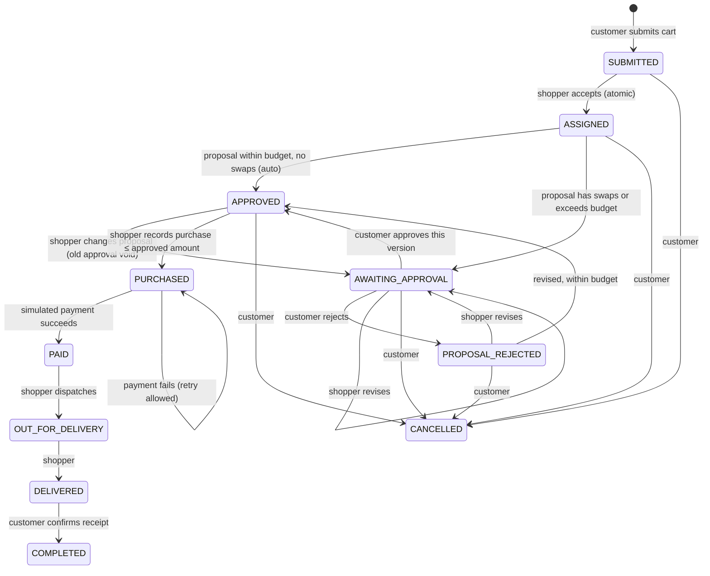
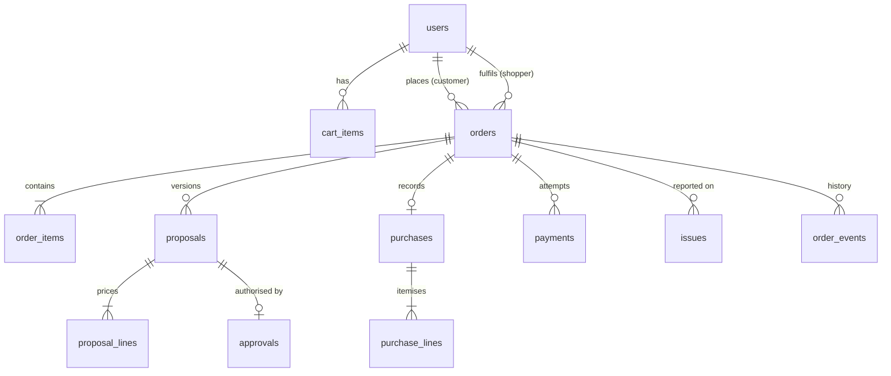

# Architecture, status model and data model

## Overview

```
React SPA (web/)  ──HTTP/JSON──▶  Express API (src/)  ──knex──▶  PostgreSQL
                                   │
                                   ├─ routes/index.ts      validation (zod), role checks, HTTP shape
                                   ├─ services/orders.ts   all business rules, one transaction per action
                                   ├─ domain/orderStatus.ts  status model + allowed transitions
                                   └─ auth.ts / errors.ts  JWT auth, consistent error format
```

One Node process serves the API under `/api`, the OpenAPI docs at `/docs`, and the built interface at `/`.

**Why this shape.** Every business rule lives in `services/orders.ts`, and every status change goes through one `transition()` function that checks the allowed-transitions table and writes the history row in the same transaction. That makes "reject invalid state changes" and "record who changed what" impossible to forget in a new endpoint.

## Status model



- **Cancellable** (nothing bought, no charge): `SUBMITTED`, `ASSIGNED`, `AWAITING_APPROVAL`, `PROPOSAL_REJECTED`, `APPROVED`.
- **Issue reportable** (instead of cancel): `PURCHASED` onwards, including `COMPLETED`. An open issue sets `has_open_issue` but doesn't change status, so delivery can still finish.
- Any other change returns `409 INVALID_STATE_TRANSITION` with `currentStatus` and `attemptedStatus`.

## Data model



| Table | Purpose | Integrity rules in the database |
|---|---|---|
| `users` | Accounts with role | unique email; role enum |
| `cart_items` | Customer's working list | quantity > 0 |
| `orders` | One request; status, budget, stored fee, totals | unique `(customer_id, idempotency_key)`; budget > 0 |
| `order_items` | Items copied from the cart at submission | |
| `proposals` | Versioned shopper proposals: `PENDING / APPROVED / REJECTED / SUPERSEDED` | unique `(order_id, version)` |
| `proposal_lines` | Per item: as requested, substitute, or unavailable, with unit price | |
| `approvals` | Authorises **one proposal** for a fixed amount (customer or auto) | unique `proposal_id` |
| `purchases` + `purchase_lines` | What was actually bought, store, receipt number, server-calculated totals | unique `order_id` (one purchase per order) |
| `payments` | Every simulated attempt, success or failure | unique `(order_id, idempotency_key)`; **partial unique index: one `SUCCEEDED` per order** |
| `issues` | Customer report + admin resolution notes | |
| `order_events` | Timestamped history: type, from/to status, actor id and role, note | |

Money is stored as integers in minor units (pesewas) to avoid floating-point errors.

## Integrity and concurrency decisions

| Risk | How it's prevented | Proven by |
|---|---|---|
| Two shoppers accept at once | Single conditional `UPDATE … WHERE status='SUBMITTED' AND shopper_id IS NULL`; only one row update can succeed | AS-2 |
| Concurrent actions on one order | Each action runs in a transaction that locks the order row (`SELECT … FOR UPDATE`) | double purchase test |
| Double-submitted order | `Idempotency-Key` header + unique constraint + per-customer advisory lock | repeated submission test |
| Double charge | Idempotency key per attempt (replay returns the original) **and** a partial unique index that makes a second success impossible even if the code were wrong | AS-6, AS-6b |
| Stale approval used for changed proposal | Approval references one proposal row; revising marks it `SUPERSEDED`; purchase requires an approval for the *current* proposal; approve requires the exact version | AS-4 |
| Client tampers with totals | Purchase schema is `.strict()` so a total field is rejected; payment amount always comes from the order | totals tests |
| Secrets in source or logs | Secrets only from environment variables (`.env` is git-ignored); request logs record method, path, status, time only | — |

## Tradeoffs and limitations

- **Auto-approval within budget** trades one extra customer tap for speed in the common case. See the note in `requirements.md` if the brief demands approval every time.
- **Polling, not push.** The interface refreshes after each action and on page load. Real-time updates (WebSockets) were left out to keep the scope on the brief's rules.
- **Receipts are a store name, number and note**, not uploaded images. File upload would need object storage, which the brief doesn't require.
- **Issue resolution records notes only.** Refunds are out of scope (simulated payments), so an admin records what was agreed.
- **JWT stored in `localStorage`.** Simple for a test environment; a production app would prefer HTTP-only cookies with CSRF protection.
- **Single fixed service fee** from `SERVICE_FEE_MINOR`, snapshotted per order so later fee changes never alter existing orders.
